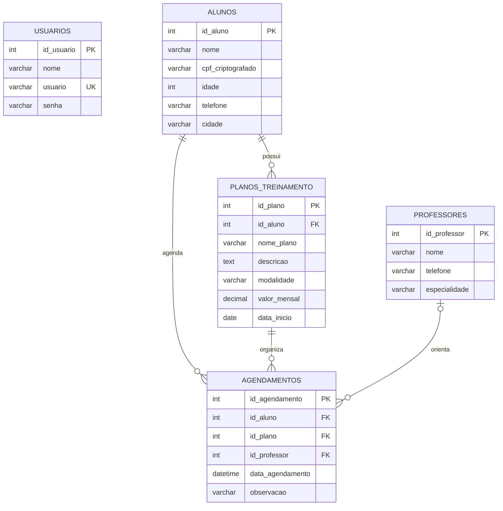

# Diagrama Entidade-Relacionamento (DER) — FitLife

## Entidades e atributos

- **USUARIOS** (`id_usuario` PK, `nome`, `usuario` UNIQUE, `senha`, `criado_em`)
- **ALUNOS** (`id_aluno` PK, `nome`, `cpf_criptografado`, `idade`, `telefone`, `cidade`, `criado_em`)
- **PROFESSORES** (`id_professor` PK, `nome`, `telefone`, `especialidade`)
- **PLANOS_TREINAMENTO** (`id_plano` PK, `id_aluno` FK, `nome_plano`, `descricao`, `modalidade`, `valor_mensal`, `data_inicio`)
- **AGENDAMENTOS** (`id_agendamento` PK, `id_aluno` FK, `id_plano` FK, `id_professor` FK opcional, `data_agendamento`, `observacao`, `criado_em`)

## Relacionamentos e cardinalidades

- ALUNOS **1:N** PLANOS_TREINAMENTO: um aluno pode ter vários planos; cada plano pertence a um aluno.
- ALUNOS **1:N** AGENDAMENTOS: um aluno pode ter vários agendamentos; cada agendamento pertence a um aluno.
- PLANOS_TREINAMENTO **1:N** AGENDAMENTOS: um plano pode estar associado a vários agendamentos.
- PROFESSORES **1:N opcional** AGENDAMENTOS: um professor pode orientar vários agendamentos; um agendamento pode não ter professor definido.
- USUARIOS é usada para autenticação e não possui relacionamento obrigatório com as demais tabelas.

## Diagrama textual

